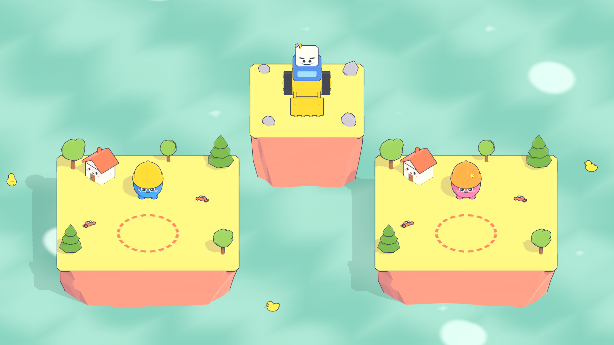

# Island Rocket Rumble

เกมยิงจรวดข้ามเกาะ 2 ผู้เล่น จอเดียว คีย์บอร์ดเดียว · Unity 6 (6000.0.85f1) · URP · Isometric low-poly พาสเทล

| | เดิน / เลื่อนกรอบ | คราฟ + ยิง | สลับเป้า (ในเมนู) |
|---|---|---|---|
| P1 ปิ๊บ | W A S D | SPACE | W / S |
| P2 โมโม่ | ลูกศร | ENTER | ↑ / ↓ |

## เปิดโปรเจกต์
1. Unity Hub → Add → เลือกโฟลเดอร์นี้ (Unity 6000.0.85f1)
2. เปิด `Assets/_Project/Scenes/Main.unity` แล้วกด Play

## เมนูเครื่องมือ (เมนู IRR ใน Unity)
- **IRR/Generate Art + Build Main Scene**: สร้างโมเดลทั้งหมดด้วยโค้ดแล้วประกอบฉากใหม่
- **IRR/Build Main Scene**: ประกอบฉากใหม่อย่างเดียว
- **IRR/Capture Main Camera**: บันทึกภาพหน้าจอไว้ที่ `Logs/capture.png`

## เอกสาร
- [Docs/GDD.md](Docs/GDD.md): เอกสารออกแบบเกม
- [Docs/CONTRACTS.md](Docs/CONTRACTS.md): สัญญาระหว่างโมดูลในโค้ด
